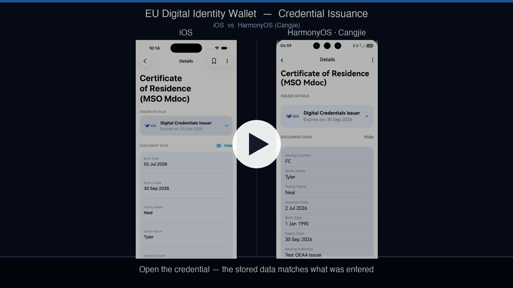

# EUDI Wallet for HarmonyOS

[English](README.md) | [简体中文](README.zh-CN.md)

A HarmonyOS port of the [EU Digital Identity Wallet](https://github.com/eu-digital-identity-wallet)
reference application. The wallet business logic and UI are written in **Cangjie + ArkUI**; a thin
ArkTS `entry` host loads the Cangjie `AppRoot` through `CJHybridComponent`.

The port follows the iOS reference implementation,
[eudi-app-ios-wallet-ui](https://github.com/eu-digital-identity-wallet/eudi-app-ios-wallet-ui),
module by module, and keeps its behaviour, screens and test cases aligned with it.

The results of testing it against the iOS reference implementation are in the
[test report](docs/test-report/README.md).

> **This is an unofficial project.** It is not affiliated with, endorsed by, or maintained by the
> European Commission. "HarmonyOS" is a trademark of Huawei Technologies Co., Ltd.

## Features

- PIN and biometric unlock
- Document list and details, including expiry and revocation status
- Credential issuance over **OpenID4VCI** (authorization code, pre-authorized code, deferred
  issuance), from the in-app issuer list, a `credential-offer` deep link or a QR code
- Remote presentation over **OpenID4VP**, with relying-party registration checks
- Proximity presentation per **ISO/IEC 18013-5** over BLE
- Remote document signing (**RQES**) via a CSC v2 qualified trust service provider
- Transaction history

- Bundle name: `eu.europa.ec.euidi`
- Target / compatible SDK: HarmonyOS `6.1.1(24)`
- Devices: phone, arm64 (`aarch64-ohos`)

## Demo

Issuance flow side by side, iOS (left) and HarmonyOS (right), from a clean install to a stored
credential:

[](docs/dual-platform-issuance-demo.mp4)

Click the image to play (1080p, 60 fps, about 96 s), or download
[`docs/dual-platform-issuance-demo.mp4`](docs/dual-platform-issuance-demo.mp4).

## Requirements

- DevEco Studio 6.1.x, which ships the HarmonyOS SDK, Hvigor, Node.js, ohpm and `hdc`
- HarmonyOS SDK `6.1.1(24)` with the matching Cangjie SDK / DevEco Cangjie plugin
- Git, and network access to GitHub for the submodules
- A HarmonyOS emulator, or an arm64 phone with developer mode and USB debugging enabled

`run_tests.sh` and `run_device_tests.sh` assume the default DevEco Studio paths on macOS. On other
platforms, build from DevEco Studio or adjust the paths at the top of the scripts.

## Build

```bash
git clone --recursive https://github.com/CJPLUK/eudi-app-hmos-wallet-ui.git
```

Open the folder in DevEco Studio, wait for Project Sync, then choose
**Build → Build Hap(s)/App(s) → Build Hap(s)**.

The root [`hvigorfile.ts`](hvigorfile.ts) prepares the build before any module is compiled:

- if the `third_party/` submodules are not checked out (cloned without `--recursive`), it runs
  `git submodule update --init`;
- if `entry/oh_modules` is missing, it runs `ohpm install --all`.

Set `SKIP_FETCH_THIRD_PARTY=1` to skip the submodule check, for example for an offline build with
`third_party/` already in place.

Outputs:

```text
entry/build/default/outputs/default/entry-default-unsigned.hap
entry/build/default/outputs/default/entry-default-signed.hap   # when signing is configured
```

### Signing

The repository ships no certificates: `signingConfigs` in `build-profile.json5` is empty. A physical
phone only installs a signed HAP. In DevEco Studio open
**File → Project Structure → Project → Signing Configs**, tick
**Automatically generate signature**, and sign in with a Huawei developer account whose profile
includes your device.

DevEco writes the certificate paths and encrypted passwords into your local
`build-profile.json5`. They are bound to your machine and must not be committed:

```bash
git update-index --skip-worktree build-profile.json5      # hide local signing changes
git update-index --no-skip-worktree build-profile.json5   # undo
```

See [INSTALL.md](INSTALL.md) for installing, launching and uninstalling the HAP.

## Third-party libraries

The protocol and crypto layers are Cangjie ports of the EUDI Wallet libraries, kept as git
submodules under `third_party/` and pinned to exact commits:

| Submodule | Role |
| --- | --- |
| `eudi_lib_wallet_kit` | Wallet facade: issuance, presentation, storage, status checks |
| `eudi_lib_openid4vp_vci` | OpenID4VCI and OpenID4VP / SIOPv2 |
| `eudi_lib_mdoc_data_model`, `eudi_lib_mdoc_security`, `eudi_lib_mdoc_transfer` | ISO/IEC 18013-5 mdoc model, security and BLE transfer |
| `eudi_lib_sdjwt` | SD-JWT VC |
| `eudi_lib_jose`, `eudi_lib_core_crypto`, `eudi_lib_x509`, `eudi_lib_cbor` | JOSE, crypto primitives, X.509, CBOR |
| `eudi_lib_statium` | Token Status List (revocation) |
| `eudi_lib_etsi_1196x2` | ETSI trusted lists |
| `eudi_lib_wallet_storage` | Document storage |
| `eudi_lib_rqes` | RQES: CSC client, signing kit and the PoDoFo native engine |

To upgrade a library, check out the new commit inside `third_party/<name>` and commit the updated
submodule pointer. Prebuilt native libraries (Cangjie stdx, OpenSSL, libc++, the PoDoFo signing
engine) live in `entry/libs/`. Licences for all of them are listed in
[THIRD_PARTY_NOTICES.md](THIRD_PARTY_NOTICES.md).

## Project structure

```text
AppScope/                 App-level configuration and icons
entry/                    ArkTS host that loads the Cangjie AppRoot
  src/main/cangjie/         Cangjie composition root and JS bridge
  src/main/ets/             EntryAbility, ArkTS pages and platform bridges
  src/ohosTest/             Test HAP: Cangjie bridge + ArkTS runner
  libs/                     Prebuilt Cangjie stdx and native libraries
Modules/                  eudi_feature_* (screens) and eudi_logic_* (business logic) modules
  eudi_unit_tests/          iOS-parity unit tests, linked only into the ohosTest HAP
third_party/              eudi_lib_* git submodules
  libphonenumber/           Phone number metadata subset and generators
githooks/                 Versioned git hooks (install with githooks/install.sh)
docs/                     Demo video, poster and test reports
```

`Modules/eudi_logic_business/src/main/cangjie/phone_metadata*.cj` are generated; regenerate them
with `third_party/libphonenumber/gen_phone_metadata.py` instead of editing them by hand. The
pre-commit hook checks that both stay in sync.

## Testing

Host-runnable logic modules:

```bash
./run_tests.sh eudi_logic_business          # one module
./run_tests.sh all                          # every host-runnable module
./run_tests.sh eudi_logic_business --filter='*FilterValidator*' --show-all-output
```

The iOS-parity feature and core tests are compiled into the **ohosTest HAP**, not the app HAP. To
build both HAPs, install them on a connected device and run the tests:

```bash
HDC_TARGET=<serial-or-host:port> ./run_device_tests.sh
```

To run the host tests before every commit, install the hook once per clone:

```bash
./githooks/install.sh          # skip once with EUDI_SKIP_TESTS=1 git commit ...
```

The latest test report, with feature coverage against iOS, iOS case parity and end-to-end
results, is in [docs/test-report](docs/test-report/README.md).

## Disclaimer

The released software is an initial development release, in line with the upstream EUDI Wallet
reference implementation:

- It may change substantially over time, add features, and change or remove existing ones,
  potentially breaking compatibility.
- It is limited in functional scope and is not yet comprehensively documented.
- It may contain errors or design flaws that could cause system or other failures and data loss.
- It has reduced security, privacy, availability and reliability standards compared with future
  releases.

Perform sufficient engineering and testing before using any part of it. **We strongly recommend not
putting this version of the software into production use.** Only the latest version is supported.

## License

Copyright (c) 2026 CJPLUK contributors.
Based on [eudi-app-ios-wallet-ui](https://github.com/eu-digital-identity-wallet/eudi-app-ios-wallet-ui),
Copyright (c) 2023-2026 European Commission.

Licensed under the **EUPL, Version 1.2** or – as soon they will be approved by the European
Commission – subsequent versions of the EUPL (the "Licence"). You may not use this work except in
compliance with the Licence. You may obtain a copy of the Licence at
https://joinup.ec.europa.eu/software/page/eupl and in [LICENSE](LICENSE).

Unless required by applicable law or agreed to in writing, software distributed under the Licence is
distributed on an "AS IS" basis, WITHOUT WARRANTIES OR CONDITIONS OF ANY KIND, either express or
implied. See the Licence for the specific language governing permissions and limitations under the
Licence.

See [NOTICE](NOTICE) for attribution and [THIRD_PARTY_NOTICES.md](THIRD_PARTY_NOTICES.md) for
third-party components.

SPDX-License-Identifier: `EUPL-1.2`
