# EUDI Wallet 鸿蒙仓颉版 · 测试报告

| 项 | 内容 |
|---|---|
| 被测项目 | `eudi-app-hmos-wallet-ui` |
| 被测版本 | `c8d48ce`（含 14 个三方库 submodule） |
| 参照基准 | iOS 参考实现 `eudi-app-ios-wallet-ui` `95b71766` |
| 测试设备 | HUAWEI Mate 60 Pro，HarmonyOS 6.1.0.125 |
| 测试日期 | 2026-10-27 至 2026-10-28 |
| 测试负责 | CJPLUK |
| 原始记录 | [records/](records/)（宿主与设备测试输出、测试环境） |

> **结论：测试通过。** 功能实现率 98.1%：iOS 参考实现的 54 个用户功能点中实现 53 个，30 个页面中实现 28 个。单元测试与端到端测试全部通过，iOS 368 个测试用例中适用的 364 个均有对应测试并通过。

| 功能实现 | 宿主单元测试用例 | 设备单元测试断言 | iOS 适用用例对齐 | 端到端测试用例 |
|:---:|:---:|:---:|:---:|:---:|
| **98.1%（53 / 54）** | **131 / 131** | **716 / 716** | **364 / 364** | **13 / 13** |
| 超过 90% | 全部通过 | 全部通过 | 100% | 全部通过 |

## 1 测试范围

- **测试目标：** 确认鸿蒙版实现了 iOS 参考实现 90% 以上的功能，已实现的功能在行为上与 iOS 一致，主要用户流程能对接真实 EUDI 服务完成。
- **功能对比：** 按 iOS 的页面与用户功能点逐项核对鸿蒙版的实现。
- **单元测试：** 以 iOS 参考实现的全部 368 个 XCTest 用例为基准，逐条移植后在 macOS 宿主和鸿蒙真机上运行。
- **端到端测试：** 在真机上覆盖登录与 PIN、证件签发与管理、交易记录、远程出示、远程签名共 13 个用例。
- **不在本轮范围：** BLE 近场出示与实体读卡器的交互（近场出示的业务逻辑由设备单元测试覆盖）。

## 2 被测对象

鸿蒙版由 ArkTS 宿主 `entry`、16 个仓颉业务模块和 14 个仓颉协议库组成，按 iOS 工程的模块结构逐一移植。iOS 与鸿蒙两端的代码规模如下。

**表 1　代码规模汇总（行，不含测试文件）**

| 部分 | iOS | 鸿蒙 | 说明 |
|---|---:|---:|---|
| 应用 | 35,365 | 48,309 | iOS：15 个模块 + 应用壳；鸿蒙：16 个模块 + `entry`（含生成的手机号元数据 1,428 行） |
| 协议库 | 75,932 | 108,631 | iOS：12 个 EUDI Swift 库（PoDoFo 原生库未计）；鸿蒙：14 个仓颉库 |
| 手写测试代码 | 10,825 | 11,370 | 不含 iOS 自动生成的 mock |
| **合计** | **122,122** | **168,310** | |

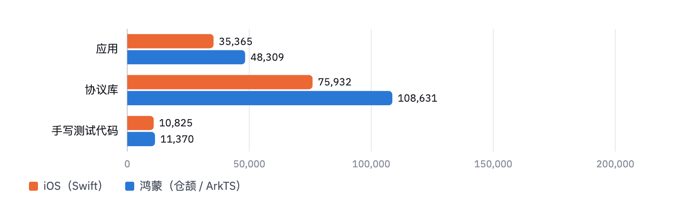

**图 1**　两端代码规模（行）。协议库：iOS 为 12 个 EUDI Swift 库，鸿蒙为 14 个仓颉库；鸿蒙多出的 X.509、CBOR、JOSE、密码学与 ETSI 信任列表在 iOS 上由系统框架或第三方库提供。测试代码：iOS 另有 Cuckoo 自动生成的 mock 约 10.4 万行，未计入。

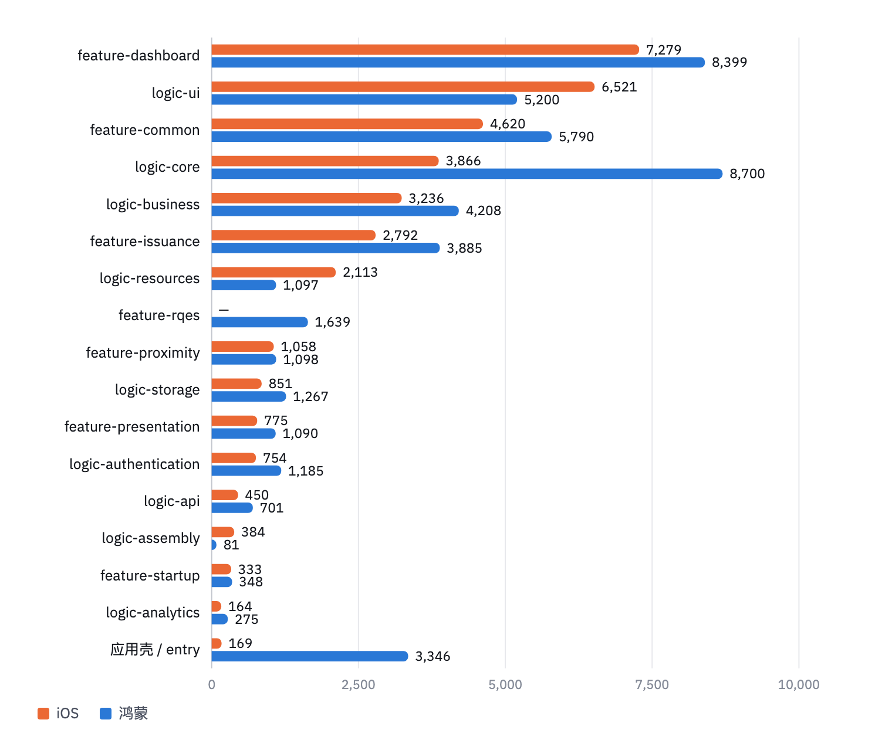

**图 2**　各应用模块两端代码行数对比。RQES 界面层在 iOS 上属于 `eudi-lib-ios-rqes-ui` 库，在鸿蒙上是独立模块 `feature_rqes`。

## 3 功能实现对比

以 iOS 参考实现为基准，从两个维度对比鸿蒙版的功能实现：页面（iOS 中可导航到的每个界面）和用户功能点（按 iOS 的界面与交互逐项列出的用户可用功能）。每一项都在鸿蒙版源码中确认了对应的页面或实现代码。

**表 2　功能实现汇总**

| 维度 | iOS | 鸿蒙已实现 | 实现率 |
|---|---:|---:|---:|
| 用户功能点 | 54 | 53 | **98.1%** |
| 页面 | 30 | 28 | **93.3%** |

**图 3**　用户功能点实现情况：98.1%（53 / 54）；不计 iOS 平台特有的证件提供方扩展时为 100%（53 / 53）。

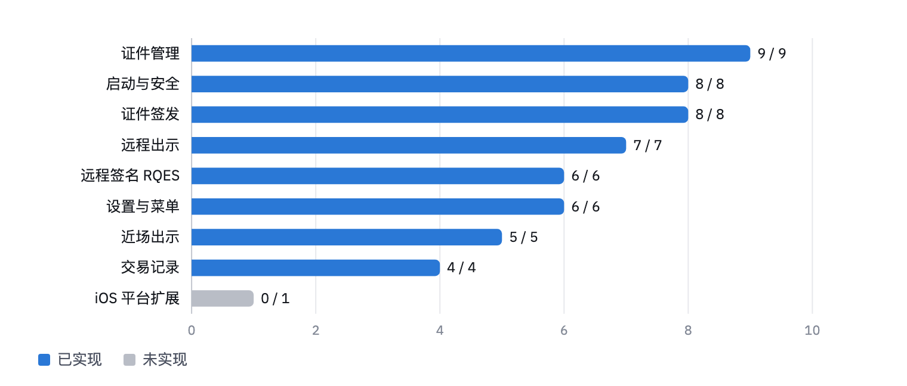

**图 4**　各功能分类的实现情况（蓝色为已实现，灰色为未实现）。

### 3.1 页面

iOS 共 30 个页面：应用 25 个，RQES 签名库 5 个。鸿蒙版实现 28 个，未实现的 2 个属于 iOS 的身份证件提供方扩展（授权页与其生物识别页），该扩展供 Safari 等应用通过 iOS 数字凭证接口向钱包请求证件。

**表 3　页面对照**

| iOS 模块 | 页面 | iOS | 鸿蒙 |
|---|---|---:|---:|
| feature-startup | 启动 | 1 | 1 |
| feature-common | 快速 PIN、扫码、生物识别、通用成功页 | 4 | 4 |
| feature-dashboard | 首页、签名入口、侧边菜单、设置、添加方式、证件详情、交易详情 | 7 | 7 |
| feature-issuance | 添加证件、签发成功、credential offer、交易码 | 4 | 4 |
| feature-presentation | 加载、请求、成功 | 3 | 3 |
| feature-proximity | 连接、请求、加载、成功 | 4 | 4 |
| RQES（eudi-lib-ios-rqes-ui） | 选文档、选签名服务、选证书、签名完成、文档查看 | 5 | 5 |
| IDP（iOS 证件提供方扩展） | 授权、生物识别 | 2 | 0 |
| **合计** | | **30** | **28** |

### 3.2 用户功能点清单

**表 4　用户功能点**

| 编号 | 功能 | 鸿蒙版 |
|---|---|---|
| | **启动与安全（8 / 8）** | |
| F-01 | 首次设置 PIN（输入并确认） | ✅ 已实现 |
| F-02 | PIN 登录 | ✅ 已实现 |
| F-03 | PIN 输错提示 | ✅ 已实现 |
| F-04 | PIN 错误次数限制 | ✅ 已实现 |
| F-05 | 修改 PIN | ✅ 已实现 |
| F-06 | 生物识别解锁 | ✅ 已实现 |
| F-07 | 按 PIN 与证件状态的启动路由 | ✅ 已实现 |
| F-08 | 相机扫描二维码 | ✅ 已实现 |
| | **证件签发（8 / 8）** | |
| F-09 | 从签发方列表添加证件 | ✅ 已实现 |
| F-10 | PID 组合签发（PID Combined） | ✅ 已实现 |
| F-11 | 扫码签发（credential offer） | ✅ 已实现 |
| F-12 | credential-offer 深链 | ✅ 已实现 |
| F-13 | 预授权码与交易码输入 | ✅ 已实现 |
| F-14 | 延迟签发与自动轮询 | ✅ 已实现 |
| F-15 | 签发成功页 | ✅ 已实现 |
| F-16 | 签发方注册校验与拦截 | ✅ 已实现 |
| | **证件管理（9 / 9）** | |
| F-17 | 证件列表 | ✅ 已实现 |
| F-18 | 证件搜索 | ✅ 已实现 |
| F-19 | 证件筛选与排序 | ✅ 已实现 |
| F-20 | 证件详情（属性、签发方、有效期与吊销状态） | ✅ 已实现 |
| F-21 | 删除证件 | ✅ 已实现 |
| F-22 | 重新签发 | ✅ 已实现 |
| F-23 | 批量凭证剩余次数显示 | ✅ 已实现 |
| F-24 | 证件收藏（书签） | ✅ 已实现 |
| F-25 | 吊销证件提醒弹窗 | ✅ 已实现 |
| | **交易记录（4 / 4）** | |
| F-26 | 交易记录列表 | ✅ 已实现 |
| F-27 | 交易搜索 | ✅ 已实现 |
| F-28 | 交易筛选 | ✅ 已实现 |
| F-29 | 交易详情 | ✅ 已实现 |
| | **远程出示（7 / 7）** | |
| F-30 | OpenID4VP 请求（扫码或深链） | ✅ 已实现 |
| F-31 | 验证方信任与注册信息展示 | ✅ 已实现 |
| F-32 | 超量请求警告 | ✅ 已实现 |
| F-33 | 选择披露字段 | ✅ 已实现 |
| F-34 | 凭证组合选择 | ✅ 已实现 |
| F-35 | 出示成功页（可展开已共享内容） | ✅ 已实现 |
| F-36 | 出示后返回验证方 | ✅ 已实现 |
| | **近场出示（5 / 5）** | |
| F-37 | 二维码 + BLE 会话 | ✅ 已实现 |
| F-38 | 蓝牙权限与开关检测、引导到设置 | ✅ 已实现 |
| F-39 | 近场请求与字段选择 | ✅ 已实现 |
| F-40 | 部分取消勾选字段后的提示 | ✅ 已实现 |
| F-41 | 近场出示成功页 | ✅ 已实现 |
| | **远程签名 RQES（6 / 6）** | |
| F-42 | 选择本地 PDF | ✅ 已实现 |
| F-43 | 选择签名服务 | ✅ 已实现 |
| F-44 | 浏览器授权并回到钱包 | ✅ 已实现 |
| F-45 | 选择签名证书 | ✅ 已实现 |
| F-46 | 签名完成与关闭确认 | ✅ 已实现 |
| F-47 | 查看与分享已签文档 | ✅ 已实现 |
| | **设置与菜单（6 / 6）** | |
| F-48 | 侧边菜单 | ✅ 已实现 |
| F-49 | 生物识别登录开关 | ✅ 已实现 |
| F-50 | 签发方注册校验开关 | ✅ 已实现 |
| F-51 | 批量凭证计数开关 | ✅ 已实现 |
| F-52 | 获取日志 | ✅ 已实现 |
| F-53 | 更新日志与版本号 | ✅ 已实现 |
| | **iOS 平台扩展（0 / 1）** | |
| F-54 | 身份证件提供方扩展（Document Provider） | ⬜ 未实现 |

## 4 测试环境

| 项 | 配置 |
|---|---|
| 测试设备 | HUAWEI Mate 60 Pro（ALN-AL80），HarmonyOS 6.1.0.125，API 24 |
| 宿主机 | macOS 26.6.2，Apple Silicon |
| 工具链 | DevEco Studio 6.1.1，Cangjie 1.1.3，hdc 3.2.0d |
| 代码获取 | 从 GitHub 全新 `git clone --recursive` |
| 服务端 | EUDI DEV / DEMO 环境：签发方 `issuer.eudiw.dev`，验证方 `verifier.eudiw.dev`，签名服务 `walletcentric.signer.eudiw.dev` |
| 网络 | 设备直连互联网，不经过 TLS 拦截代理（钱包只信任系统根证书，经过 SSL 审查的网络会使所有 HTTPS 请求被拒绝） |
| 执行命令 | 宿主 `./run_tests.sh all`；设备 `./run_device_tests.sh`；端到端 `hdc` + `uitest` |

## 5 测试方法

| 测试类型 | 运行位置 | 用例来源 | 通过标准 |
|---|---|---|---|
| 宿主单元测试 | macOS，`cjpm test` | iOS `logic-*` 模块测试，按方法 1:1 移植 | FAILED = 0 且 ERROR = 0 |
| 设备单元测试 | 鸿蒙真机，测试 HAP + `aa test` | iOS `feature-*` 与 `logic-ui` 测试，按测试类成套移植 | failed = 0 且 error = 0 |
| 端到端测试 | 鸿蒙真机 + 真实 EUDI 服务 | 钱包主要用户流程 | 界面结果与对端服务反馈符合预期 |

- 每个 iOS 测试用例在对照表中记录对应的鸿蒙测试；无法对应的，记明理由。
- PIN 的 PBKDF2 派生用相同的盐、PIN 和 210,000 轮迭代，与 iOS CommonCrypto 的输出逐字节比对。
- 测试代码只打进测试 HAP，应用 HAP 不含测试代码。

## 6 单元测试结果

| 测试类型 | 数量 | 通过 | 失败 | 错误 | 结果 |
|---|---:|---:|---:|---:|---|
| 宿主单元测试 | 131 个用例 | 131 | 0 | 0 | ✅ 通过 |
| 设备单元测试 | 716 条断言 | 716 | 0 | 0 | ✅ 通过 |

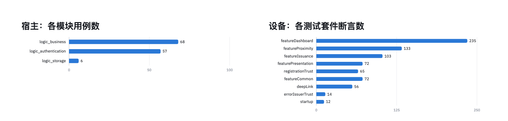

**图 5**　单元测试分布。左：宿主单元测试各模块用例数；右：设备单元测试各套件断言数。设备侧按套件源码中的断言统计，共 762 处，其中位于失败分支、通过时不执行的不计，运行时为 716 条。

### 6.1 与 iOS 测试用例的对齐

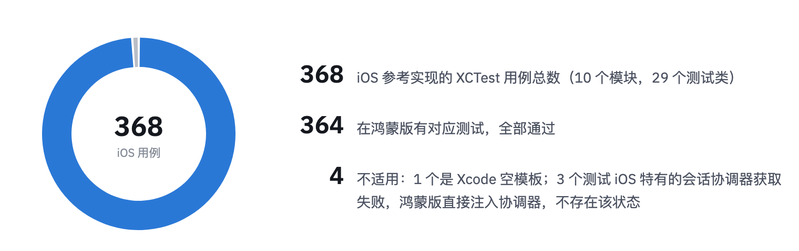

**图 6**　iOS 参考实现 368 个测试用例的对齐结果。

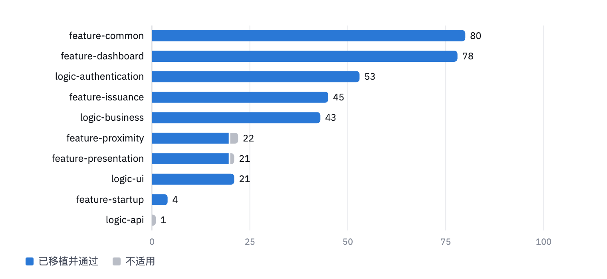

**图 7**　各 iOS 模块的用例数与对齐结果（蓝色为已移植并通过，灰色为不适用）。

**表 5　各模块 iOS 用例与鸿蒙测试的对应**

| iOS 模块 | 测试内容 | iOS 用例 | 已移植 | 不适用 | 鸿蒙测试 |
|---|---|---:|---:|---:|---|
| feature-common | 生物识别、快速 PIN、扫码、签发方信任、注册信任 | 80 | 80 | 0 | 设备 |
| feature-dashboard | 首页、证件、交易记录、设置 | 78 | 78 | 0 | 设备 |
| logic-authentication | PIN 存储、PIN 节流、生物识别控制器 | 53 | 53 | 0 | 宿主 |
| feature-issuance | 添加证件、证件 offer | 45 | 45 | 0 | 设备 |
| logic-business | 筛选与表单校验 | 43 | 43 | 0 | 宿主 |
| feature-proximity | 近场出示 | 22 | 20 | 2 | 设备 |
| feature-presentation | 远程出示 | 21 | 20 | 1 | 设备 |
| logic-ui | 深链路由 | 21 | 21 | 0 | 设备 |
| feature-startup | 启动路由 | 4 | 4 | 0 | 设备 |
| logic-api | 空模板 | 1 | 0 | 1 | — |
| **合计** | | **368** | **364** | **4** | |

## 7 端到端测试结果

13 个用例全部通过。

| 编号 | 用例 | 预期结果 | 结果 |
|---|---|---|---|
| | **登录与 PIN** | | |
| E-01 | 全新安装后首次启动，设置并确认 6 位 PIN | 显示 “Your wallet is secured!”，进入首页 | ✅ 通过 |
| E-02 | PIN 持久化：结束应用后重新启动 | 显示 “Welcome back!” 登录页，输入已设置的 PIN 进入首页 | ✅ 通过 |
| E-03 | 输入错误的 PIN | 输入框标红并提示 “Invalid pin”，停留在登录页；随后输入正确 PIN 可进入 | ✅ 通过 |
| E-04 | 修改 PIN：输入当前 PIN，设置并确认新 PIN，重启后登录 | 提示修改成功；旧 PIN 被拒绝，新 PIN 可登录 | ✅ 通过 |
| E-05 | 连续冷启动 10 次 | 每次都能进入登录页，无崩溃、无卡死 | ✅ 通过 |
| | **证件与交易记录** | | |
| E-06 | 无证件时打开 Documents 与 History 页 | 两页正常显示空状态 “No results” | ✅ 通过 |
| E-07 | OpenID4VCI 签发证件：选择证件类型，在签发方页面完成授权 | 签发成功，证件出现在 Documents 列表，可打开查看详情 | ✅ 通过 |
| E-08 | 删除已签发的证件 | 确认后证件从 Documents 列表中移除 | ✅ 通过 |
| E-09 | 证件收藏：在证件详情页点击收藏按钮，离开后重新进入，再次点击 | 提示 “Saved to favorites”，图标变为实心；重新进入后仍为已收藏；再次点击提示 “Removed from favorites”，图标恢复空心 | ✅ 通过 |
| E-10 | 签发、出示后查看 History | History 列出对应的签发与出示记录 | ✅ 通过 |
| | **出示与签名** | | |
| E-11 | 扫码进入签发或出示流程 | 相机识别二维码后进入对应流程 | ✅ 通过 |
| E-12 | OpenID4VP 远程出示：打开验证方请求，确认披露内容，输入 PIN 提交 | 显示出示成功，验证方收到证件 | ✅ 通过 |
| E-13 | RQES 远程签名：选择 PDF 与签名服务，浏览器授权后回到钱包，选择证书并输入 PIN | 得到已签名文档 | ✅ 通过 |

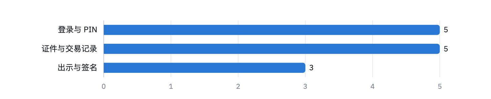

**图 8**　端到端用例按功能分类的数量，全部通过。

### 7.1 截图

| E-01 首次启动 | E-01 确认 PIN | E-01 设置完成 | E-01 首页 |
|:---:|:---:|:---:|:---:|
|  |  |  | 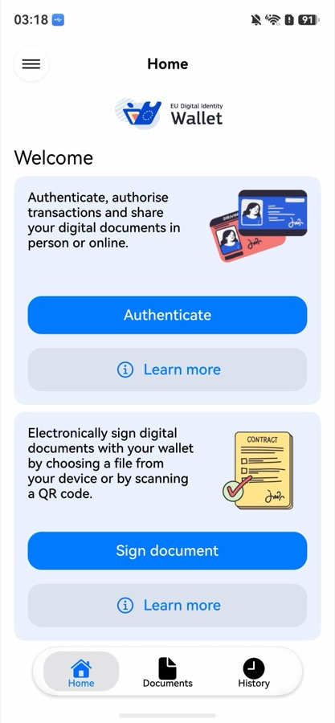 |

| E-02 重启后登录 | E-03 PIN 错误 | E-04 修改 PIN | E-04 修改成功 |
|:---:|:---:|:---:|:---:|
|  |  | 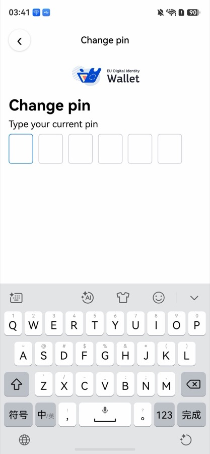 | 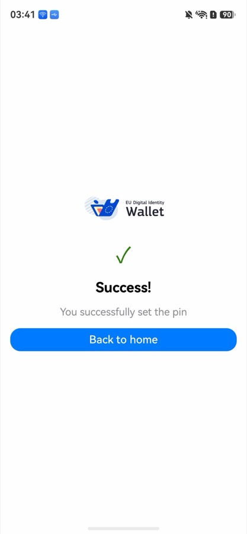 |

| E-04 旧 PIN 失效 | E-06 Documents | E-06 History | E-09 已收藏 |
|:---:|:---:|:---:|:---:|
| 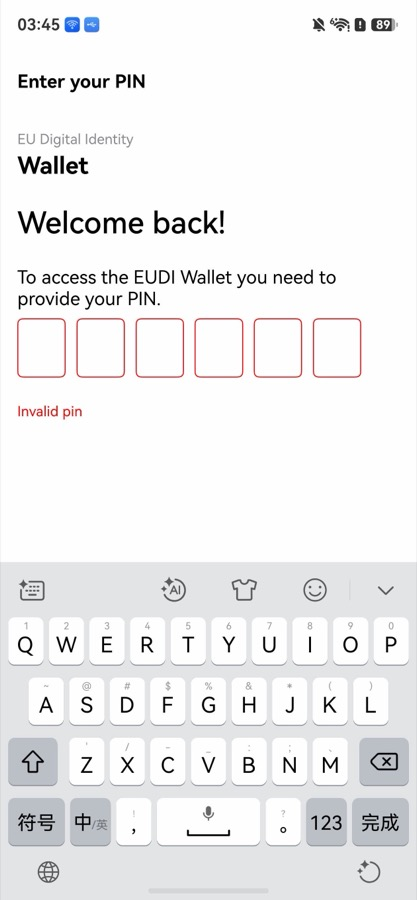 |  |  |  |

| E-09 取消收藏 |
|:---:|
|  |

## 8 测试结论

- 功能实现率 98.1%：iOS 54 个用户功能点中实现 53 个；30 个页面中实现 28 个（93.3%）。
- 宿主单元测试 131 个用例、设备单元测试 716 条断言全部通过。
- iOS 参考实现 368 个测试用例中，适用的 364 个在鸿蒙版均有对应测试并通过。
- 端到端测试 13 个用例全部通过，覆盖登录与 PIN、证件签发与管理、交易记录、远程出示和远程签名。
- 结论：被测版本 `c8d48ce` 测试通过。
