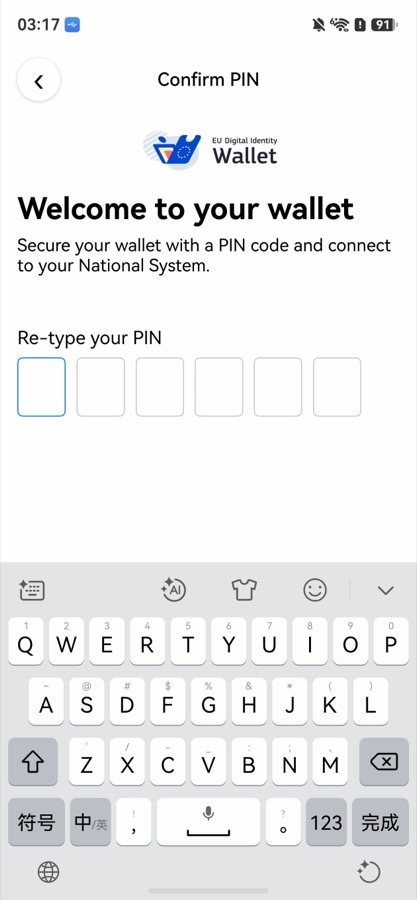

# EUDI Wallet 鸿蒙仓颉版 · 测试报告

中文 | [English](README.en.md)

| 项 | 内容 |
|---|---|
| 文档类型 | 测试完成报告（Test Completion Report，结构参照 ISO/IEC/IEEE 29119-3） |
| 被测对象 | `eudi-app-hmos-wallet-ui`：EU Digital Identity Wallet 参考应用的 HarmonyOS 移植（仓颉 + ArkUI），包名 `eu.europa.ec.euidi` |
| 参照对象 | iOS 参考实现 [eudi-app-ios-wallet-ui](https://github.com/eu-digital-identity-wallet/eudi-app-ios-wallet-ui)（源码锁定 `95b71766`，2026-09-01），XCTest 共 368 个用例 |
| 计分构建 | `0e1f5c5`（14 个 `third_party/eudi_lib_*` submodule 按该提交锁定的版本） |
| 报告日期 | 2026-10-27 |
| 原始记录 | [records/](records/)（宿主 / 设备测试输出、环境信息） |

## 1. 结论摘要

| 指标 | 数值 | 口径 |
|---|---|---|
| 宿主单元测试 | **131 / 131 通过** | `./run_tests.sh all`，`@TestCase` 计数；logic 层可在 macOS 上运行的模块 |
| 设备单元测试 | **630 通过 / 0 失败 / 0 错误** | `./run_device_tests.sh`，真机 `aa test`，按执行到的断言计数 |
| iOS 用例对齐率 | **90.7%**（330 / 364） | 已迁移且通过的 iOS 用例 ÷（iOS 用例总数 368 − 不适用 4）；未迁移 34 例计入分母 |
| 端到端（本构建） | 1 例执行，1 例通过 | 冷启动与首次设置 PIN（E-01） |
| 端到端（历史构建） | 9 例通过 | 签发、远程出示、扫码、RQES 签名、信任链探针等；在开源前的内部构建上执行，**未在计分构建上复跑** |
| 端到端（未测） | 5 例 | BLE 近场对真实读卡器、DCQL 最小披露、线上无 x5c 的 SD-JWT、HUKS 禁止导出、生物识别真机解锁 |

**结论**：
- **单元测试层：通过。** 计分构建上宿主与设备单元测试全部通过；与 iOS 用例逐条对照，未迁移的只有注册信任层 UI 模型的 34 例（第 7.3 节）。
- **端到端层：部分验证。** 核心链路（签发、远程出示、RQES 签名）在历史构建上走通过真实 EUDI 服务，但计分构建上只做了冷启动冒烟；BLE 近场无线电、DCQL 最小披露等 5 项从未验证。**不能据此宣称钱包已完成端到端验收。**

## 2. 测试方法

### 2.1 依据

- **ISO/IEC/IEEE 29119-3**（测试文档）：按测试完成报告的要素组织，依次为范围、方法、环境、结果、偏差、残留风险。
- **ISO/IEC 25010 功能适合性**：评价功能完整性与功能正确性，即鸿蒙版能否完成与 iOS 参考实现相同的操作、得到相同的结果。
- **结果呈现**：参照 Android CTS 结果摘要与 OpenHarmony XTS summary_report，先给总数，再分模块，最后列失败与未测详情。

### 2.2 测试层次与用例来源

| 层次 | 运行位置 | 用例来源 | 依赖 |
|---|---|---|---|
| L1 宿主单元测试 | macOS，`cjpm test` | iOS `logic-*` 模块的 XCTest，**方法级 1:1** 移植为 `@TestCase` | 真实校验器 / PBKDF2；Keychain 用手写 Fake |
| L2 设备单元测试 | 鸿蒙真机，ohosTest HAP（`aa test`） | iOS `feature-*` 与 `logic-ui` 的 XCTest，**套件级**移植：一条 iOS 方法对应若干条断言 | 交互器、视图模型、协调器为真实代码；钱包引擎、远端 / 近场会话用手写 Fake |
| L3 端到端 | 鸿蒙真机或模拟器 + 真实 EUDI 服务 | 用户可见的主流程：签发、出示、签名、扫码、信任链 | 真实 issuer / verifier / QTSP（DEV 或 DEMO 环境） |

**iOS 对齐规则**：iOS 每个 `func test*` 在对照台账中占一行，必须有对应的仓颉断言（已迁移）或写明理由（不适用）；不得以“预计失败”为由跳过。只有两类允许记为不适用：iOS 自动生成的空模板，以及只在 iOS 自身架构中存在的状态（见第 5.1 节）。

### 2.3 执行与判定

1. **宿主**：`./run_tests.sh all` 依次运行 `eudi_logic_business`、`eudi_logic_api`、`eudi_logic_authentication`、`eudi_logic_storage`，读取 `cjpm test` 的 `PASSED / FAILED / ERROR` 汇总。
2. **设备**：`./run_device_tests.sh` 构建应用 HAP 与 ohosTest HAP，安装到真机后执行 `aa test`；测试入口 `runAllUnitSuites()` 依次运行 8 个套件，输出 `CJ_TEST_SUMMARY: passed=… failed=… error=…`。只有 `failed=0` 且 `error=0` 才判通过。
3. **端到端**：在真机上按用户路径操作，以界面截图、应用日志（hilog）和对端服务的反馈（如 verifier 前端显示收到的属性）为证据。
4. **测试库隔离**：`libeudi_unit_tests.so` 只打进 ohosTest HAP，应用 HAP 不含测试代码。

### 2.4 结论定义

| 报告结论 | 含义 | 计入通过 |
|---|---|---|
| 通过 | 在计分构建上执行，判定标准全部满足 | 是 |
| 修复后验证通过 | 在本轮较早的构建上失败，修复后在计分构建上通过（第 7.1 节） | 是 |
| 历史证据 | 在开源前的内部构建上执行并通过，有开发记录或日志；未在计分构建上复跑 | 不计入本构建通过率，单列 |
| 未测 | 缺少对端设备、服务端不支持或尚未安排，从未执行 | 否 |
| 未迁移 | iOS 有该用例，仓颉侧尚无对应断言 | 否（计入对齐率分母） |
| 不适用 | iOS 用例无行为可迁，或测试的状态在仓颉设计中不存在 | 不计入对齐率分母 |

## 3. 测试环境

| 项 | 被测端 | 参照端 |
|---|---|---|
| 设备 | HUAWEI Mate 60 Pro（ALN-AL80）真机 | iPhone 17 Pro 模拟器（历史轮次） |
| 系统 | HarmonyOS `6.1.0.125`，API 24 | iOS 模拟器（版本见历史记录） |
| 应用 | `eu.europa.ec.euidi`，计分构建 `0e1f5c5`，debug 签名 | `eudi-app-ios-wallet-ui` `95b71766` |
| 构建工具 | DevEco Studio 6.1.1，Cangjie 1.1.3（cjnative），hvigor，hdc 3.2.0d | Xcode |
| 宿主机 | macOS 26.6.2（arm64） | 同左 |
| 服务端 | EUDI DEV / DEMO 环境：`issuer.eudiw.dev`、`dev.verifier.eudiw.dev`、`verifier-backend.eudiw.dev`、`walletcentric.signer.eudiw.dev` | 同左 |

宿主测试需要 `export DEVELOPER_DIR=/Library/Developer/CommandLineTools`：Xcode 自带的 macOS 27 SDK 中 `libSystem.tbd` 含 `arm64e.x1` 架构，仓颉链接器无法解析（第 6.3 节）。

## 4. 结果总览

### 4.1 按测试层

| 层 | 构建 | 用例 / 断言 | 通过 | 失败 | 错误 / 未测 | 结论 |
|---|---|---|---|---|---|---|
| L1 宿主单元测试 | `0e1f5c5` | 131 个用例 | 131 | 0 | 0 | 通过 |
| L2 设备单元测试 | `0e1f5c5` | 630 条断言 | 630 | 0 | 0 | 通过 |
| L3 端到端（本构建） | `0e1f5c5` | 1 | 1 | 0 | 0 | 通过 |
| L3 端到端（历史构建） | 内部构建，见第 8 章 | 9 | 9 | 0 | 0 | 历史证据 |
| L3 端到端（未测） | — | 5 | — | — | 5 | 未测 |

### 4.2 按功能板块（iOS 用例对齐）

| 板块 | iOS 用例 | 已迁移 | 不适用 | 未迁移 | 仓颉侧 | 对齐率 |
|---|---|---|---|---|---|---|
| [feature-startup](#startup) 启动路由 | 4 | 4 | 0 | 0 | 设备 `startup` 12 条 | 100% |
| [feature-common](#common) PIN / 生物识别 / 扫码 / 签发方信任 / 注册信任 | 80 | 46 | 0 | 34 | 设备 `featureCommon` 64 条、`errorIssuerTrust` 14 条 | 57.5% |
| [feature-issuance](#issuance) 添加证件 / 证件 offer | 45 | 45 | 0 | 0 | 设备 `featureIssuance` 103 条 | 100% |
| [feature-dashboard](#dashboard) 首页 / 证件 / 交易 / 设置 | 78 | 78 | 0 | 0 | 设备 `featureDashboard` 222 条 | 100% |
| [feature-presentation](#presentation) 远程出示 | 21 | 20 | 1 | 0 | 设备 `featurePresentation` 72 条 | 100% |
| [feature-proximity](#proximity) 近场出示 | 22 | 20 | 2 | 0 | 设备 `featureProximity` 133 条 | 100% |
| [logic-ui](#logicui) 深链路由 | 21 | 21 | 0 | 0 | 设备 `deepLink` 56 条 | 100% |
| [logic-authentication](#auth) PIN 存储 / 节流 / 生物识别控制器 | 53 | 53 | 0 | 0 | 宿主 57 个用例 | 100% |
| [logic-business](#business) 筛选 / 表单校验 | 43 | 43 | 0 | 0 | 宿主 68 个用例 | 100% |
| logic-api | 1 | 0 | 1 | 0 | — | — |
| **合计** | **368** | **330** | **4** | **34** | 设备 630 条（运行时）/ 宿主 131 个 | **90.7%** |

说明：
- 设备侧“条”是各套件源码中的断言调用点（静态计数，合计 676）。运行时实际执行 630 条，差额是 `if / else` 守卫中的失败分支，正常路径下不会执行。
- 宿主侧另有 `eudi_logic_storage` 6 个用例，iOS 无对应测试，不计入对齐。宿主 `eudi_logic_business` 的 68 个用例中，除 iOS 的 43 个外，还覆盖了配置、偏好设置、日期与字符串工具、手机号元数据等仓颉侧路径。

## 5. 分功能结果与证据

### 5.1 单元测试

**feature-startup**：`TestStartupInteractor` 4 例全部迁移，覆盖首次启动、已设 PIN、有无证件时的路由。

**feature-common**：

| iOS 测试类 | 用例 | 结论 | 说明 |
|---|---|---|---|
| TestBiometryInteractor | 22 | 已迁移 · 通过 | 含真实生物识别移植后的错误通道（`biometryError`，第 7.1 节） |
| TestQuickPinInteractor | 11 | 已迁移 · 通过 | |
| TestScannerInteractor | 3 | 已迁移 · 通过 | |
| TestErrorIssuerTrust | 10 | 已迁移 · 通过 | 签发方不受信任时的错误分类 |
| TestRelyingPartyRegistrationUiModel | 17 | **未迁移** | 注册信任层 UI 模型，见第 7.3 节 |
| TestPresentationPolicyViolationOverasking | 10 | **未迁移** | 同上 |
| TestPolicyPurposeLocalized | 4 | **未迁移** | 同上 |
| TestRequestDataUiModelSelection | 3 | **未迁移** | 同上 |

**feature-issuance**：`TestAddDocumentInteractor` 25 例、`TestDocumentOfferInteractor` 20 例全部迁移，含 iOS 2026-09 新增的 5 例签发方注册拦截用例（全部签发方不可信、部分失败、注册被阻止、注册不担保、offer 被阻止）。

**feature-dashboard**：7 个测试类 78 例全部迁移，是断言拆分最细的套件（222 条）；包括批量签发计数开关对证件卡片 badge 的影响（第 7.1 节）。

**feature-presentation**：20 例迁移；1 例不适用：

| iOS 用例 | 结论 | 理由 |
|---|---|---|
| `testOnSendResponse_WhenSecondGetActiveRemoteCoordinatorThrows_ThenReturnsFailure` | 不适用 | iOS 测的是自身 `SessionCoordinatorHolder` 第二次取协调器失败；仓颉直接注入协调器，不存在这一状态 |

**feature-proximity**：20 例迁移；2 例不适用，理由同上（`testOnResponsePrepare_…GetActiveProximityCoordinatorThrowsError…`、`testOnSendResponse_…GetActiveProximityCoordinatorThrowsError…`）。设备套件还驱动真实近场协调器走完 poweredOn → qrEngagementReady → connected → started → requestReceived → userSelected → responseSent → disconnected 全序列，并覆盖 BLE 可用性映射、取消即停、无线电关闭等路径。

**logic-ui**：`TestDeepLinkController` 21 例全部迁移，含 `openid4vp`、`openid-credential-offer`、`rqes` 等 scheme。

**logic-authentication**（宿主）：5 个测试类 53 例**方法级 1:1** 迁移；另有 2 个 PIN PBKDF2 金向量用例（同一盐、同一 PIN、210000 轮，与 iOS CommonCrypto 输出逐字节比对）和 2 个仓颉侧新增路径，合计 57 个用例。

**logic-business**（宿主）：`TestFilterValidator` 23 例、`TestFormValidator` 20 例全部迁移。

### 5.2 端到端

| ID | 场景 | 结论 | 构建 / 日期 | 证据 | 说明 |
|---|---|---|---|---|---|
| E-01 | 冷启动 → 设置并确认 6 位 PIN → 进入首页 | 通过 | `0e1f5c5` · 2026-10-27 | [evidence/E-01](evidence/E-01/) | 全新安装；全程进程未重启，无崩溃记录；[执行记录](evidence/E-01/run_log.md) |
| E-02 | OpenID4VCI 授权码签发 PID（`issuer.eudiw.dev`），双端对照 | 历史证据 | 内部构建 · 2026-07 | [双端演示视频](../../dual-platform-issuance-demo.mp4) | 设置 PIN → 添加证件 → 授权 → 签发成功 → 核对存储内容 |
| E-03 | OpenID4VCI 签发 Health ID（MSO mdoc），holder 密钥在 HUKS | 历史证据 | 内部构建 · 2026-08-26 | 开发记录（hilog） | `HuksSecureArea.createKeyBatch` → `issue … via SecureArea` → 签发入库；未出现软件密钥签名 |
| E-04 | OpenID4VP 远程出示 EHIC → DEV verifier，前端核对属性 | 历史证据 | 内部构建 · 2026-07-06 · 模拟器 | 开发记录 | reader 证书可信徽章 → Share → PIN → 成功页；verifier 前端解出 `issuing_authority` 等属性 |
| E-05 | OpenID4VP 远程出示 Health ID，DeviceAuth 由 HUKS 签名 | 历史证据 | 内部构建 · 2026-08-26 | 开发记录（hilog） | `DeviceAuth signing with SecureArea` → `direct_post` HTTP 200 → 成功页 |
| E-06 | 相机扫码（HMS Scan Kit）进入签发 / 出示 | 历史证据 | 内部构建 · 2026-08 | 用户确认 | |
| E-07 | RQES 远程签名全流程 | 历史证据 | 内部构建 · 2026-09-06 | 开发记录 | 选文档 → 选 QTSP → 系统浏览器 OAuth（`rqes://oauth/callback` 回跳）→ 选证书 → PIN → 签名成功 |
| E-08 | 信任锚：DEMO LoTE 加载 | 历史证据 | 内部构建 · 2026-08-28 | 开发记录（hilog） | `LOTE: pid=7 wrpac=7` |
| E-09 | 近场 reader 证书不可信时失败关闭 | 历史证据 | 内部构建 · 2026-08-28 | 开发记录（hilog） | 合成 DeviceRequest：`reader x5c not trusted (fail-closed)` |
| E-10 | SD-JWT 无 x5c 时经 JWKS 验签（合成签发方） | 历史证据 | 内部构建 · 2026-08-28 | 开发记录（hilog） | 合成探针 `SDJWT-JWKS probe ok`；线上见 E-12 |
| E-11 | BLE 近场出示（ISO 18013-5）对真实读卡器 | 未测 | — | — | 缺少对端读卡器；代码链路与设备单测已就绪 |
| E-12 | 线上无 x5c 的 SD-JWT 经签发方 JWKS 验签 | 未测 | — | — | DEMO 签发方 `/.well-known/jwt-vc-issuer` 返回 400 |
| E-13 | OpenID4VP DCQL 最小披露（只请求 `age_over_18`） | 未测 | — | — | iOS 应用层同样无此测试 |
| E-14 | HUKS 中的 holder 密钥禁止导出 | 未测 | — | — | 代码请求 never-export，失败时回退；未实测 |
| E-15 | 生物识别真机解锁 | 未测 | — | — | 已接入 UserAuthenticationKit，本报告无可引用的真机记录 |

E-01 证据（计分构建，全新安装后冷启动）：

   

## 6. 仓颉能力边界

### 6.1 结论

本章回答：哪些钱包功能因为仓颉 SDK 6.1 缺少对应接口而只能经 ArkTS 桥接实现。依据是代码中的桥接实现与注释（`entry/src/main/ets/pages/Index.ets`）以及开发记录。

- **仓颉做不到、且无替代路径的功能：0 项。**
- **仓颉侧无接口、已经 ArkTS 桥接：4 项**，均在用（6.2）。
- 桥接的共同代价：保留的 JS 函数不能从仓颉工作线程调用，命令以字符串形式排队，在 ArkTS 事件循环上执行；平台调用阻塞的是工作线程，不阻塞 UI 线程。

### 6.2 受仓颉能力限制、已桥接的功能

| 项 | 用户能看到的功能 | 仓颉侧缺口 | 现状 |
|---|---|---|---|
| B1 | 生物识别解锁、设置中的生物识别开关、跳转系统生物识别设置 | 无 `UserAuthenticationKit`（userIAM）绑定 | ArkTS 桥接；启动前探测设备能力并发布给仓颉控制器，设置页跳转用 ArkTS `settings.openBiometricsSettingsPage` |
| B2 | 相机扫码（签发 offer、出示请求） | HMS Scan Kit 无仓颉绑定 | ArkTS 桥接；`startScanForResult` 必须在 ArkUI 页面上下文中调用 |
| B3 | RQES 选择待签名的 PDF | `DocumentViewPicker` 无仓颉绑定 | ArkTS 桥接；文件复制到应用缓存后把路径交给仓颉，保留原文件名 |
| B4 | BLE 近场出示的 GATT 外设与蓝牙开关状态 | 仓颉 ConnectivityKit 在 HarmonyOS 6.1.1 上拒绝 `addService`；无 `ohos.bluetooth.access` 绑定 | ArkTS 桥接；无线电状态取自适配器状态，GATT 通知 / 停止操作在 ArkTS 事件循环上排空 |

### 6.3 仓颉开发注意事项（有绕法，不算能力缺失）

| 现象 | 后果 | 处理 |
|---|---|---|
| `@Builder` / `build` 中不能使用 `match` | 编译失败 | 改用 `if (opt.isSome()) { … opt.getOrThrow() … }` |
| hvigor 按模块各自的资源表编译 `@r` 宏 | 跨 feature 模块直接依赖时资源宏在空表上展开失败 | 通过启动器接缝（如 `RqesSigningLauncher`）在 `entry` 组合根注入 |
| 构造器内逃逸闭包不能捕获 `this` | 编译失败 | 先拷贝到局部 `let`，闭包捕获局部变量 |
| 依赖设备专属 OHOS 包的代码放进可在宿主运行的模块 | 宿主单测整体无法编译 | 设备实现放到 `entry`，逻辑模块只留接口（第 7.1 节） |
| 同一工程并发两个 hvigor 构建，或应用 HAP 与测试 HAP 先后构建 | 模块增量缓存损坏，秒级报假 `Out of memory` | 删除对应 `Modules/<模块>/build` 后重跑 |
| Xcode 27 的 macOS SDK（`libSystem.tbd` 含 `arm64e.x1`） | 仓颉链接器解析失败，宿主测试无法链接 | `export DEVELOPER_DIR=/Library/Developer/CommandLineTools` |

## 7. 缺陷、修复与残留风险

### 7.1 本轮修复（较早构建上失败 → 计分构建上通过）

| 问题 | 失败表现 | 修复 | 计分构建结果 |
|---|---|---|---|
| 宿主单测无法编译 | `eudi_logic_business` 引入设备专属的 `ohos.ability_access_ctrl`，4 个宿主模块全部编译失败 | 把 `ReachabilityControllerImpl`（蓝牙权限申请、系统设置跳转）移到 `entry/src/main/cangjie/reachability_impl.cj`，逻辑不变 | 131 / 131 |
| `biometry.authenticate_deniedAccess_pinError` | 断言检查 `pinError`，实际错误走 `biometryError`（iOS 的 alert 通道） | 断言改查 `biometryError` | 通过 |
| `settings.openBiometrySettings_availabilityGate_available` | 测试用的生物识别 Fake 没有设置 `biometryType` | 补设 `BiometryType.FaceID` | 通过 |
| `proximity.connectionVm_initialize_receivesRequest` | `receiveRequest` 在异步工作线程执行，断言早于调用 | 断言前等待调用完成 | 通过 |
| `docTab.usageBadge_shownWhenBatchCounterOn` | 测试文档用的是 `FakeDocClaims`，生产代码只为 `IssuedDocument` 生成计数 badge | 测试文档改为 `IssuedDocument` | 通过 |
| 签发日志泄露敏感值 | `eudi_lib_wallet_kit` 恢复授权时以明文打印授权码、state 与 PKCE verifier | 改为只打印授权码长度与 state 是否匹配 | 设备单测通过；E-01 通过 |

以上 4 个设备用例的修复只改测试代码，生产代码未变；在 `3773356` 上为 626 通过 / 4 失败，修复后为 630 / 0 / 0。

### 7.2 历史轮次中已关闭的 RQES 界面差距

2026-09-04 的 iOS / 鸿蒙 RQES 双端逐屏对比记录了 9 处差距（G1–G9）。在计分构建的代码中核对：

| 差距 | 内容 | 现状 |
|---|---|---|
| G1 | 签名成功页缺“Data shared”结构与关闭确认弹窗 | 已实现（`signed_document_view.cj`） |
| G2 | 数据共享请求页缺凭证组合单选 | 已实现（`e95848e` 组合请求模型与界面） |
| G4a | 文档选择页关闭时缺“Cancel signing process?”确认 | 已实现（`document_selection_view.cj`） |
| G4b | 显示临时文件名而非原文件名 | 已实现（文件选择桥保留原文件名） |
| G8 | 共享后流程停住，Done 无法续跑签名 | 部分：Done 后可续跑（`165ce75`）；iOS 为自动续跑，鸿蒙仍需点 Done |
| G9 | 步骤文案与 iOS 不一致 | 已实现（`rqes_view_models.cj`） |
| G3 / G4c / G5 / G6 / G7 | 标题对齐、步骤完成态、返回按钮样式、选中勾颜色、verifier 名称 | 未逐项复核 |

以上为代码核对结论，**未在计分构建上做 RQES 真机复跑**。

### 7.3 残留风险

| 类别 | 说明 |
|---|---|
| 端到端未在计分构建上复跑 | E-02 至 E-10 都在开源前的内部构建上执行；计分构建只做了冷启动冒烟（E-01）。建议在 `0e1f5c5` 上补一轮签发、出示、RQES 的真机端到端 |
| 注册信任层单元测试未迁移 | iOS 2026-09 新增的 34 例（`TestRelyingPartyRegistrationUiModel` 等）在本仓库中无对应测试。生产代码已移植（`registration_ui_model.cj`），但没有单元测试保护 |
| BLE 近场无线电 | 代码链路完整、设备单测驱动真实协调器，但从未与真实读卡器（如 `eudi-app-multiplatform-verifier-ui`）配对；广播发现、CCCD 订阅、notify 背压、ReaderAuth 对真实证书链均未验证 |
| 单元测试依赖 Fake | 设备单测中钱包引擎、远端 / 近场会话均为 Fake，全绿只说明交互器与视图模型逻辑正确，不能推出真实协议正确 |
| 安全属性 | HUKS 密钥是否真正禁止导出、是否在 TEE 中未实测；没有与 iOS Secure Enclave 等价的密钥证明链 |
| iOS 参照未复跑 | iOS XCTest 上次本机执行是 2026-08-24（329 / 0，当时 iOS 用例为 329 个）；对 368 个用例的 iOS 侧本轮未复跑 |
| OpenSSL 版本 | RQES 签名引擎 `libpodofo_rqes.so` 静态链接的 OpenSSL 1.1.1u 已停止维护 |
| 覆盖率与性能 | 未采集代码覆盖率，未做性能基准 |

## 8. 构建与轮次

| 轮次 | 构建 | 范围 | 结果 |
|---|---|---|---|
| R1 | `3773356` | 宿主 + 设备单元测试 | 宿主 131 / 131；设备 626 通过 / 4 失败 / 0 错误 |
| R2 | `a23e8dc` | 设备单元测试（4 个测试修复后） | 630 / 0 / 0 |
| **R3（计分）** | **`0e1f5c5`** | 从 GitHub 全新 `clone --recursive`，宿主 + 设备单元测试 + E-01 | 宿主 131 / 131；设备 630 / 0 / 0；E-01 通过 |
| H1 | 内部构建 · 2026-07 | E-02（双端签发演示）、E-04（远程出示，模拟器） | 通过 |
| H2 | 内部构建 · 2026-08-24 / 25 | 设备单元测试 ×4、iOS XCTest | 设备 506 / 0 / 0（四次一致）；iOS 329 / 0 |
| H3 | 内部构建 · 2026-08-26 / 28 | E-03、E-05、E-08、E-09、E-10 | 通过 |
| H4 | 内部构建 · 2026-09-06 | E-07（RQES 全流程） | 通过 |

R1 → R3 之间的代码差异只有第 7.1 节所列的 4 个测试修复；R3 与 R2 代码一致（仅文档与提交历史不同）。

## 9. 参考资料

- ISO/IEC/IEEE 29119-3:2021, *Software and systems engineering — Software testing — Part 3: Test documentation*：<https://www.iso.org/standard/79429.html>
- ISO/IEC 25010:2023, *Systems and software Quality Requirements and Evaluation (SQuaRE) — Product quality model*：<https://www.iso.org/standard/78176.html>
- Android Compatibility Test Suite — Interpret CTS results：<https://source.android.com/docs/compatibility/cts/interpret>
- OpenHarmony XTS 测试子系统：<https://gitee.com/openharmony/xts_acts>
- iOS 参考实现：<https://github.com/eu-digital-identity-wallet/eudi-app-ios-wallet-ui>
- 本次测试的原始输出与环境信息：[records/](records/)
