# EUDI Wallet for HarmonyOS (Cangjie) · Test Report

[中文](README.zh-CN.md) | English

| Item | Details |
|---|---|
| Project under test | `eudi-app-hmos-wallet-ui` |
| Version under test | `c8d48ce` (with the 14 third-party library submodules) |
| Reference | iOS reference implementation `eudi-app-ios-wallet-ui` `95b71766` |
| Test device | HUAWEI Mate 60 Pro, HarmonyOS 6.1.0.125 |

> **Verdict: passed.** Feature coverage is 98.1%: 53 of the 54 user features of the iOS reference implementation are implemented, along with 28 of its 30 screens. All unit tests and end-to-end tests pass, and each of the 364 applicable iOS test cases (out of 368) has a matching test that passes.

| Feature coverage | Host unit test cases | Device unit test assertions | Applicable iOS cases matched | End-to-end test cases |
|:---:|:---:|:---:|:---:|:---:|
| **98.1% (53 / 54)** | **131 / 131** | **716 / 716** | **364 / 364** | **13 / 13** |
| Above 90% | All passed | All passed | 100% | All passed |

## 1 Scope

- **Goal:** confirm that the HarmonyOS port implements more than 90% of the features of the iOS reference implementation, that the implemented features behave as they do on iOS, and that the main user flows complete against the real EUDI services.
- **Feature comparison:** the port is checked screen by screen and feature by feature against iOS.
- **Unit tests:** all 368 XCTest cases of the iOS reference implementation are the baseline; each was ported and runs on a macOS host or on a HarmonyOS device.
- **End-to-end tests:** 13 cases on a real device covering login and PIN, issuing and managing documents, transaction history, remote presentation and remote signing.
- **Out of scope for this round:** BLE proximity presentation against a physical reader (the proximity business logic is covered by the device unit tests).

## 2 Test item

The port consists of the ArkTS host `entry`, 16 Cangjie application modules and 14 Cangjie protocol libraries, ported module by module from the structure of the iOS project. The code size of both sides is below.

**Table 1　Code size (lines, test files excluded)**

| Part | iOS | HarmonyOS | Notes |
|---|---:|---:|---|
| App | 35,365 | 48,309 | iOS: 15 modules + app shell; HarmonyOS: 16 modules + `entry` (including 1,428 lines of generated phone-number metadata) |
| Protocol libraries | 75,932 | 108,631 | iOS: 12 EUDI Swift libraries (the native PoDoFo library not counted); HarmonyOS: 14 Cangjie libraries |
| Hand-written test code | 10,825 | 11,370 | iOS mocks generated by Cuckoo excluded |
| **Total** | **122,122** | **168,310** | |

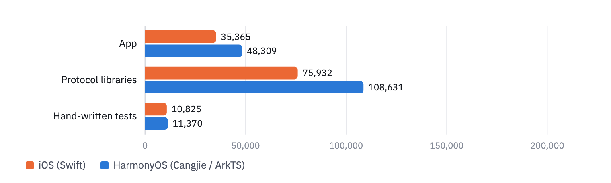

**Figure 1**　Code size on both sides (lines). Protocol libraries: 12 EUDI Swift libraries on iOS, 14 Cangjie libraries on HarmonyOS; the extra X.509, CBOR, JOSE, cryptography and ETSI trusted-list code on HarmonyOS comes from system frameworks or third-party libraries on iOS. Test code: about 104,000 lines of mocks generated by Cuckoo on iOS are not counted.

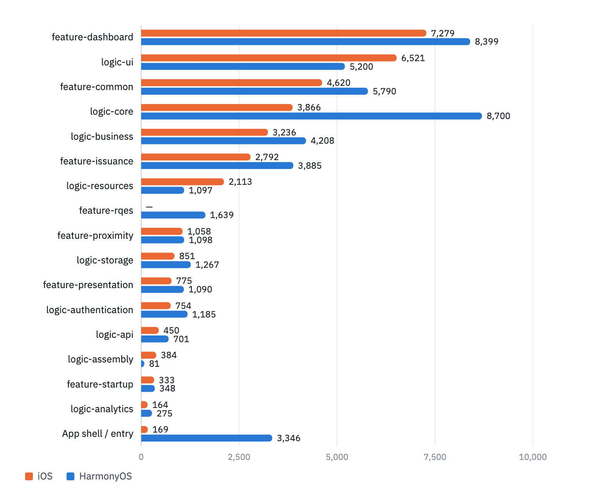

**Figure 2**　Lines of code per app module on both sides. The RQES UI layer is part of the `eudi-lib-ios-rqes-ui` library on iOS and a separate module, `feature_rqes`, on HarmonyOS.

## 3 Feature comparison

The port is compared with the iOS reference implementation along two dimensions: screens (every screen that can be navigated to on iOS) and user features (the features available to the user, listed from the iOS screens and interactions). For each item, the matching screen or code was located in the port's source.

**Table 2　Feature coverage summary**

| Dimension | iOS | Implemented on HarmonyOS | Coverage |
|---|---:|---:|---:|
| User features | 54 | 53 | **98.1%** |
| Screens | 30 | 28 | **93.3%** |

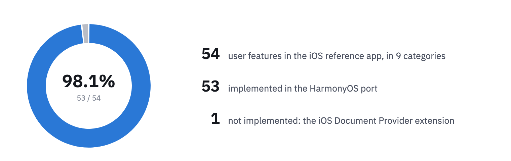

**Figure 3**　User feature coverage: 98.1% (53 / 54); 100% (53 / 53) without the iOS-only Document Provider extension.

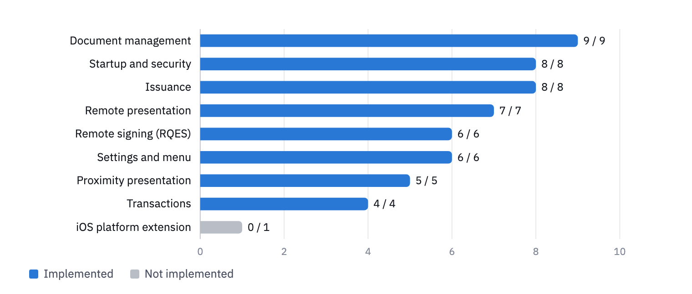

**Figure 4**　Coverage by feature category (blue: implemented, gray: not implemented).

### 3.1 Screens

iOS has 30 screens: 25 in the app and 5 in the RQES signing library. The port implements 28. The 2 it lacks belong to the iOS identity Document Provider extension (its authorization screen and the biometric screen it opens), which lets apps such as Safari request documents from the wallet through the iOS Digital Credentials API.

**Table 3　Screens**

| iOS module | Screens | iOS | HarmonyOS |
|---|---|---:|---:|
| feature-startup | Startup | 1 | 1 |
| feature-common | Quick PIN, scanner, biometrics, generic success | 4 | 4 |
| feature-dashboard | Home, sign entry, side menu, settings, add-document options, document details, transaction details | 7 | 7 |
| feature-issuance | Add document, issuance success, credential offer, transaction code | 4 | 4 |
| feature-presentation | Loading, request, success | 3 | 3 |
| feature-proximity | Connection, request, loading, success | 4 | 4 |
| RQES (eudi-lib-ios-rqes-ui) | Choose document, choose signing service, choose certificate, signing done, document viewer | 5 | 5 |
| IDP (iOS Document Provider extension) | Authorization, biometrics | 2 | 0 |
| **Total** | | **30** | **28** |

### 3.2 User features

**Table 4　User features**

| ID | Feature | HarmonyOS |
|---|---|---|
| | **Startup and security (8 / 8)** | |
| F-01 | First-time PIN setup (enter and confirm) | ✅ Implemented |
| F-02 | PIN login | ✅ Implemented |
| F-03 | Wrong-PIN message | ✅ Implemented |
| F-04 | Limit on wrong PIN attempts | ✅ Implemented |
| F-05 | Change PIN | ✅ Implemented |
| F-06 | Biometric unlock | ✅ Implemented |
| F-07 | Startup routing by PIN and document state | ✅ Implemented |
| F-08 | QR code scanning with the camera | ✅ Implemented |
| | **Issuance (8 / 8)** | |
| F-09 | Add a document from the issuer list | ✅ Implemented |
| F-10 | Combined PID issuance (PID Combined) | ✅ Implemented |
| F-11 | Issuance by scanning a credential offer | ✅ Implemented |
| F-12 | credential-offer deep links | ✅ Implemented |
| F-13 | Pre-authorized code and transaction code entry | ✅ Implemented |
| F-14 | Deferred issuance with automatic polling | ✅ Implemented |
| F-15 | Issuance success screen | ✅ Implemented |
| F-16 | Issuer registration check and blocking | ✅ Implemented |
| | **Document management (9 / 9)** | |
| F-17 | Document list | ✅ Implemented |
| F-18 | Document search | ✅ Implemented |
| F-19 | Document filtering and sorting | ✅ Implemented |
| F-20 | Document details (attributes, issuer, validity and revocation status) | ✅ Implemented |
| F-21 | Delete a document | ✅ Implemented |
| F-22 | Re-issue | ✅ Implemented |
| F-23 | Remaining batch credentials | ✅ Implemented |
| F-24 | Document bookmarks (favorites) | ✅ Implemented |
| F-25 | Revoked-documents modal | ✅ Implemented |
| | **Transactions (4 / 4)** | |
| F-26 | Transaction list | ✅ Implemented |
| F-27 | Transaction search | ✅ Implemented |
| F-28 | Transaction filtering | ✅ Implemented |
| F-29 | Transaction details | ✅ Implemented |
| | **Remote presentation (7 / 7)** | |
| F-30 | OpenID4VP request (QR code or deep link) | ✅ Implemented |
| F-31 | Verifier trust and registration information | ✅ Implemented |
| F-32 | Over-asking warning | ✅ Implemented |
| F-33 | Choose the disclosed fields | ✅ Implemented |
| F-34 | Credential combination choice | ✅ Implemented |
| F-35 | Presentation success screen (shared data expandable) | ✅ Implemented |
| F-36 | Return to the verifier after presenting | ✅ Implemented |
| | **Proximity presentation (5 / 5)** | |
| F-37 | QR code + BLE session | ✅ Implemented |
| F-38 | Bluetooth permission and on/off checks, link to settings | ✅ Implemented |
| F-39 | Proximity request and field selection | ✅ Implemented |
| F-40 | Warning after deselecting some fields | ✅ Implemented |
| F-41 | Proximity presentation success screen | ✅ Implemented |
| | **Remote signing, RQES (6 / 6)** | |
| F-42 | Choose a local PDF | ✅ Implemented |
| F-43 | Choose a signing service | ✅ Implemented |
| F-44 | Authorize in the browser and return to the wallet | ✅ Implemented |
| F-45 | Choose a signing certificate | ✅ Implemented |
| F-46 | Signing done, with close confirmation | ✅ Implemented |
| F-47 | View and share the signed document | ✅ Implemented |
| | **Settings and menu (6 / 6)** | |
| F-48 | Side menu | ✅ Implemented |
| F-49 | Biometric login switch | ✅ Implemented |
| F-50 | Issuer registration check switch | ✅ Implemented |
| F-51 | Batch credential counter switch | ✅ Implemented |
| F-52 | Retrieve logs | ✅ Implemented |
| F-53 | Changelog and version number | ✅ Implemented |
| | **iOS platform extension (0 / 1)** | |
| F-54 | Identity Document Provider extension | ⬜ Not implemented |

## 4 Test environment

| Item | Configuration |
|---|---|
| Test device | HUAWEI Mate 60 Pro (ALN-AL80), HarmonyOS 6.1.0.125, API 24 |
| Host | macOS 26.6.2, Apple Silicon |
| Toolchain | DevEco Studio 6.1.1, Cangjie 1.1.3, hdc 3.2.0d |
| Source | Fresh `git clone --recursive` from GitHub |
| Services | EUDI DEV / DEMO environments: issuer `issuer.eudiw.dev`, verifier `verifier.eudiw.dev`, signing service `walletcentric.signer.eudiw.dev` |
| Network | Device connected directly to the internet, with no TLS-intercepting proxy (the wallet trusts only the system root certificates, so on a network with SSL inspection every HTTPS request is rejected) |
| Commands | Host `./run_tests.sh all`; device `./run_device_tests.sh`; end-to-end `hdc` + `uitest` |

## 5 Test method

| Test type | Runs on | Source of the cases | Pass criteria |
|---|---|---|---|
| Host unit tests | macOS, `cjpm test` | iOS `logic-*` module tests, ported 1:1 by method | FAILED = 0 and ERROR = 0 |
| Device unit tests | HarmonyOS device, test HAP + `aa test` | iOS `feature-*` and `logic-ui` tests, ported as whole test classes | failed = 0 and error = 0 |
| End-to-end tests | HarmonyOS device + real EUDI services | The wallet's main user flows | UI results and the services' responses as expected |

- Each iOS test case is mapped to its HarmonyOS test in a mapping table; cases with no counterpart record the reason.
- PIN key derivation (PBKDF2) is run with the same salt, PIN and 210,000 iterations and compared byte for byte with the output of iOS CommonCrypto.
- Test code is packaged only into the test HAP; the app HAP contains none.

## 6 Unit test results

| Test type | Count | Passed | Failed | Errors | Result |
|---|---:|---:|---:|---:|---|
| Host unit tests | 131 cases | 131 | 0 | 0 | ✅ Passed |
| Device unit tests | 716 assertions | 716 | 0 | 0 | ✅ Passed |

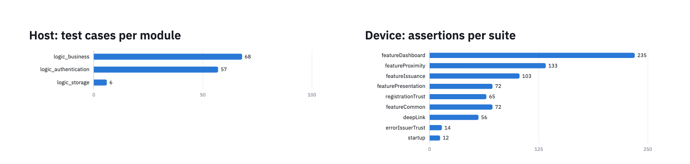

**Figure 5**　Unit test distribution. Left: host unit test cases per module; right: device unit test assertions per suite. The device counts are assertions in each suite's source, 762 in total; those on failure branches, which do not run when the tests pass, are excluded, leaving 716 at run time.

### 6.1 Matching the iOS test cases

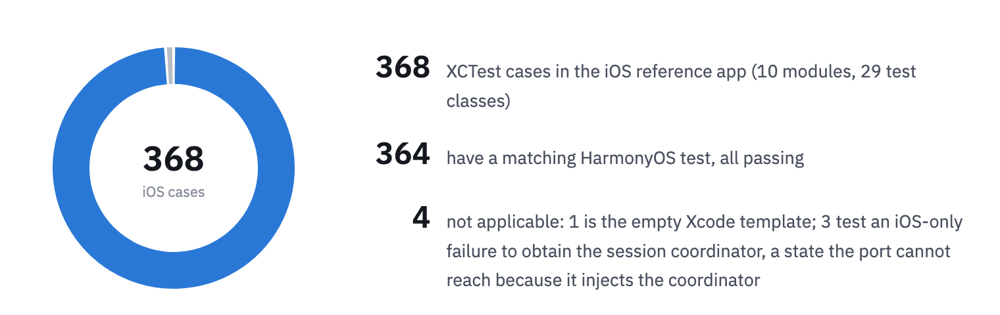

**Figure 6**　Matching results for the 368 test cases of the iOS reference implementation.

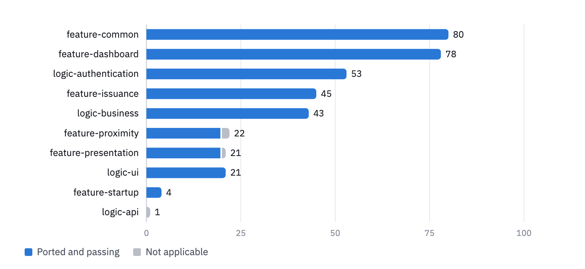

**Figure 7**　Cases and matching results per iOS module (blue: ported and passing, gray: not applicable).

**Table 5　iOS cases and HarmonyOS tests per module**

| iOS module | What is tested | iOS cases | Ported | Not applicable | HarmonyOS tests |
|---|---|---:|---:|---:|---|
| feature-common | Biometrics, quick PIN, scanner, issuer trust, registration trust | 80 | 80 | 0 | Device |
| feature-dashboard | Home, documents, transaction history, settings | 78 | 78 | 0 | Device |
| logic-authentication | PIN storage, PIN throttling, biometry controller | 53 | 53 | 0 | Host |
| feature-issuance | Add document, document offer | 45 | 45 | 0 | Device |
| logic-business | Filters and form validation | 43 | 43 | 0 | Host |
| feature-proximity | Proximity presentation | 22 | 20 | 2 | Device |
| feature-presentation | Remote presentation | 21 | 20 | 1 | Device |
| logic-ui | Deep-link routing | 21 | 21 | 0 | Device |
| feature-startup | Startup routing | 4 | 4 | 0 | Device |
| logic-api | Empty template | 1 | 0 | 1 | — |
| **Total** | | **368** | **364** | **4** | |

## 7 End-to-end test results

All 13 cases passed.

| ID | Case | Expected result | Result |
|---|---|---|---|
| | **Login and PIN** | | |
| E-01 | First launch after a fresh install; set and confirm a 6-digit PIN | "Your wallet is secured!" is shown, then the home screen | ✅ Passed |
| E-02 | PIN persistence: stop the app and launch it again | The "Welcome back!" login screen is shown; the PIN set earlier opens the home screen | ✅ Passed |
| E-03 | Enter a wrong PIN | The fields turn red with "Invalid pin" and the login screen stays; the correct PIN then gets in | ✅ Passed |
| E-04 | Change PIN: enter the current PIN, set and confirm a new one, log in after a restart | Success is shown; the old PIN is rejected and the new one logs in | ✅ Passed |
| E-05 | 10 cold starts in a row | The login screen appears every time, with no crash or freeze | ✅ Passed |
| | **Documents and history** | | |
| E-06 | Open Documents and History with no documents | Both show the empty state "No results" | ✅ Passed |
| E-07 | OpenID4VCI issuance: choose a document type and complete authorization on the issuer's page | Issuance succeeds; the document appears in Documents and its details open | ✅ Passed |
| E-08 | Delete an issued document | After confirming, the document is removed from Documents | ✅ Passed |
| E-09 | Bookmarks: tap the bookmark button on the document details screen, leave and come back, tap it again | "Saved to favorites" is shown and the icon fills; it is still bookmarked after coming back; the second tap shows "Removed from favorites" and the icon is an outline again | ✅ Passed |
| E-10 | View History after issuing and presenting | History lists the issuance and presentation records | ✅ Passed |
| | **Presentation and signing** | | |
| E-11 | Start issuance or presentation by scanning a QR code | The camera reads the code and the matching flow starts | ✅ Passed |
| E-12 | OpenID4VP remote presentation: open a verifier request, confirm what is disclosed, submit with the PIN | Presentation success is shown and the verifier receives the document | ✅ Passed |
| E-13 | RQES remote signing: choose a PDF and a signing service, authorize in the browser and return to the wallet, choose a certificate and enter the PIN | A signed document is produced | ✅ Passed |

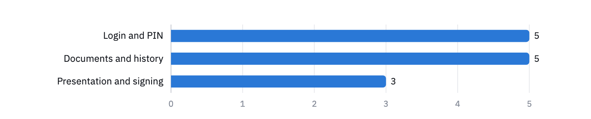

**Figure 8**　Number of end-to-end cases per category, all passed.

### 7.1 Screenshots

| E-01 First launch | E-01 Confirm PIN | E-01 Setup done | E-01 Home |
|:---:|:---:|:---:|:---:|
|  |  |  |  |

| E-02 Login after restart | E-03 Wrong PIN | E-04 Change PIN | E-04 PIN changed |
|:---:|:---:|:---:|:---:|
| 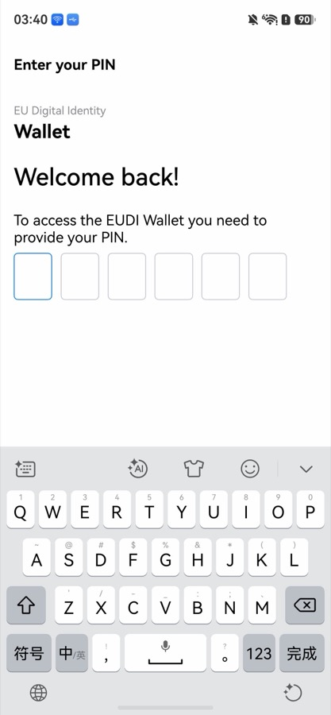 | 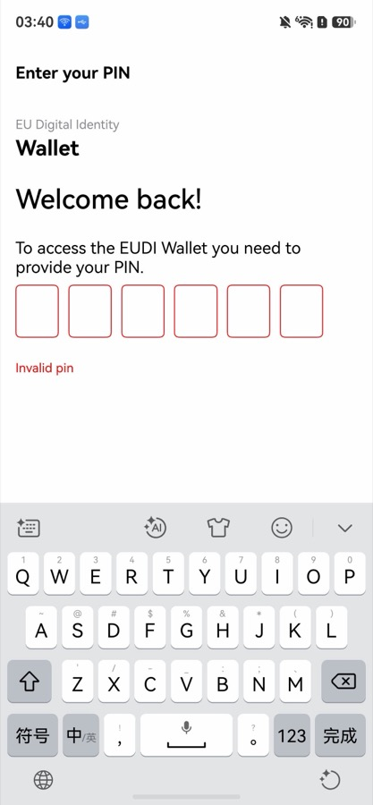 |  |  |

| E-04 Old PIN rejected | E-06 Documents | E-06 History | E-09 Bookmarked |
|:---:|:---:|:---:|:---:|
|  | 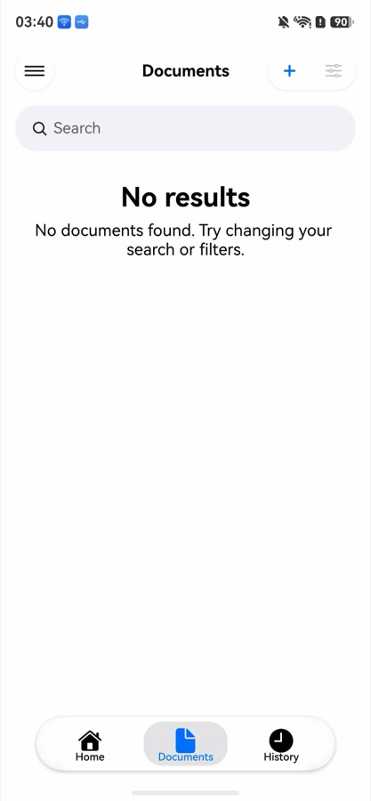 | 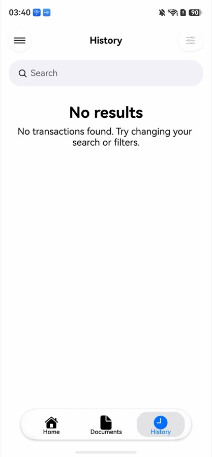 | 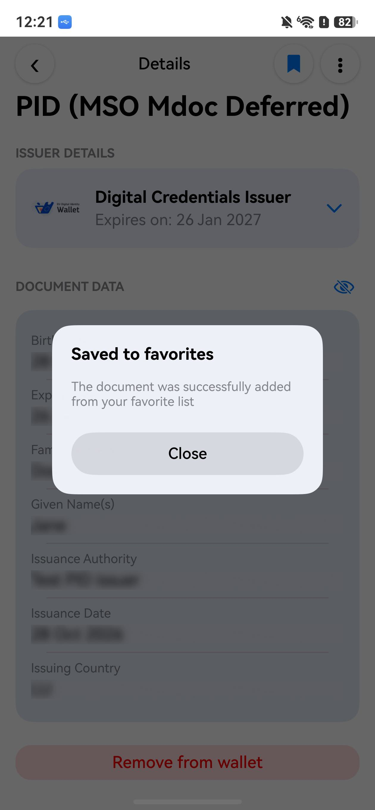 |

| E-09 Bookmark removed |
|:---:|
| 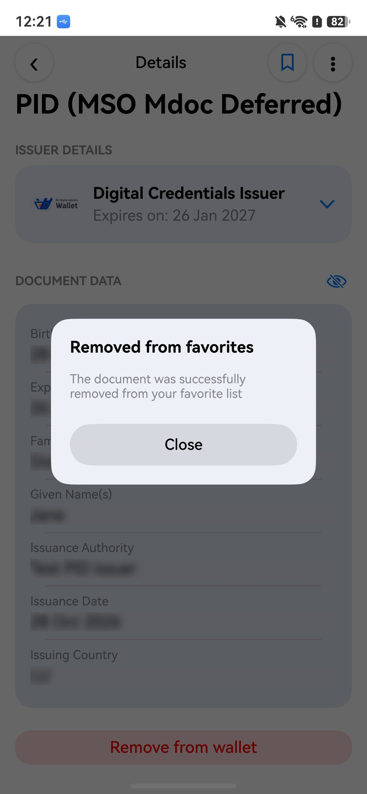 |

## 8 Conclusion

- Feature coverage is 98.1%: 53 of the 54 iOS user features are implemented; 28 of the 30 screens are implemented (93.3%).
- All 131 host unit test cases and all 716 device unit test assertions pass.
- Of the 368 test cases of the iOS reference implementation, each of the 364 applicable ones has a matching test in the port, and all of them pass.
- All 13 end-to-end cases pass, covering login and PIN, issuing and managing documents, transaction history, remote presentation and remote signing.
- Verdict: version `c8d48ce` passed.
